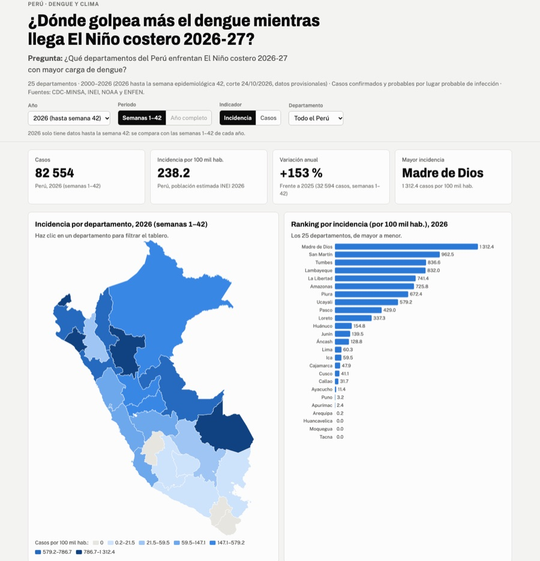
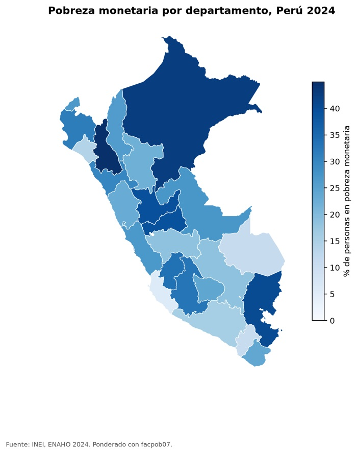
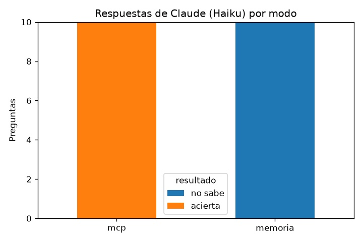

Licenciada en Economía por la Universidad del Pacífico y analista en el Ministerio de Educación del Perú.

[CV en PDF](/files/cv.pdf) · [GitHub](https://github.com/jyauric) · [LinkedIn](https://www.linkedin.com/in/josselinyauri19)

## Proyectos

### Dengue y El Niño costero en el Perú: tablero interactivo y reel

**Pregunta:** ¿qué departamentos enfrentan El Niño costero 2026-27 con mayor carga de dengue?

**Resultado:** 82 554 casos hasta la semana 42 de 2026; La Libertad, Piura y Lambayeque concentran el 51.4 %.

[Tablero](https://jyauric.github.io/dengue-nino-peru/web/) · [Código](https://github.com/jyauric/dengue-nino-peru) · [Reel](https://github.com/jyauric/dengue-nino-peru/blob/main/reel/salidas/reel.mp4) (voz generada con IA a partir de mi voz)

### Tres skills de Claude Code que limpian, grafican y mapean la ENAHO 2024

**Pregunta:** ¿puede un agente limpiar la ENAHO y replicar la pobreza oficial?

**Resultado:** 27.53 % de pobreza monetaria frente al 27.6 % oficial del INEI, con 108,664 residentes habituales.

[Código](https://github.com/jyauric/enaho-skills) · [Evaluación](https://github.com/jyauric/enaho-skills/blob/main/evaluacion.md)

### Un servidor MCP que conecta a Claude con las series del BCRP

**Pregunta:** ¿cuántas cifras oficiales entrega Claude sin el servidor y cuántas con él?

**Resultado:** 10 de 10 aciertos con el servidor, cada uno con su fuente; sin él no respondió ninguna de las 10 preguntas.

[Código](https://github.com/jyauric/mcp-bcrp) · [Informe](https://github.com/jyauric/mcp-bcrp/blob/main/informe.md)

## Demo: tablero de dengue

<iframe src="https://jyauric.github.io/dengue-nino-peru/web/" title="Tablero de dengue y El Niño costero en el Perú" loading="lazy" style="width:100%;height:640px;border:1px solid #ccc"></iframe>

[Abrir el tablero en pantalla completa](https://jyauric.github.io/dengue-nino-peru/web/)

Música del reel: "Dreams Become Real", Kevin MacLeod (incompetech.com), CC BY 4.0. Este sitio y los proyectos se hicieron con apoyo de Claude Code; revisé las cifras contra las fuentes.
