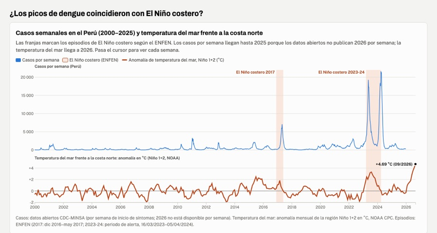

{{ page.pregunta }}

<strong>{{ page.cifra }}</strong> {{ page.cifra_texto }}

## Qué encontré

- **La carga se concentra en la costa norte y la Amazonía.** La Libertad (16 174 casos), Piura (14 761) y Lambayeque (11 506) suman el 51.4 % de los casos; por habitante encabezan Madre de Dios (1 312 por 100 mil hab.) y San Martín (963), frente a 238 a nivel nacional.
- **Los picos de dengue coincidieron con El Niño costero.** En el episodio 2023-24 se notificaron en promedio 6 816 casos por semana, unas 14 veces el promedio del resto de semanas de 2000–2025. Es una coincidencia en el tiempo; no demuestra causalidad.
- **2026 es el tercer año con más casos desde 2000 a la misma semana,** con 2.5 veces los casos de 2025 (32 594).

## Pruébalo

<iframe src="https://jyauric.github.io/dengue-nino-peru/web/" title="Tablero de dengue y El Niño costero en el Perú" loading="lazy"></iframe>

  <a class="boton boton--principal" href="https://jyauric.github.io/dengue-nino-peru/web/">Abrir el tablero</a>
  <a class="boton" href="https://github.com/jyauric/dengue-nino-peru">Ver el código</a>
  <a class="boton" href="https://github.com/jyauric/dengue-nino-peru/blob/main/reel/salidas/reel.mp4">Ver el reel</a>

**Fuentes:** CDC-MINSA, INEI, NOAA y ENFEN. Los datos de 2026 son provisionales (corte 24/10/2026).

**Reel:** la voz fue generada con IA a partir de mi voz. Música: "Dreams Become Real", Kevin MacLeod (incompetech.com), CC BY 4.0.
