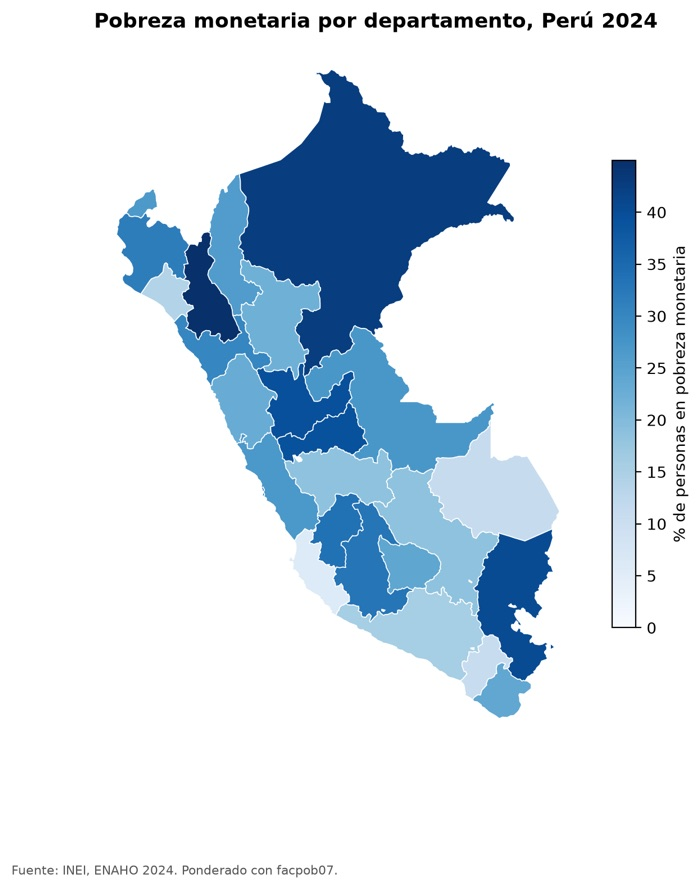

**Pregunta:** ¿puede un agente limpiar la ENAHO y replicar la pobreza oficial?

**Resultado:** 27.53 % de pobreza monetaria frente al 27.6 % oficial del INEI, con 108,664 residentes habituales.

[Código](https://github.com/jyauric/enaho-skills) · [Evaluación](https://github.com/jyauric/enaho-skills/blob/main/evaluacion.md)
