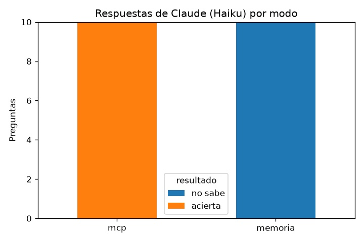

**Pregunta:** ¿cuántas cifras oficiales entrega Claude sin el servidor y cuántas con él?

**Resultado:** 10 de 10 aciertos con el servidor, cada uno con su fuente; sin él no respondió ninguna de las 10 preguntas.

[Código](https://github.com/jyauric/mcp-bcrp) · [Informe](https://github.com/jyauric/mcp-bcrp/blob/main/informe.md)
